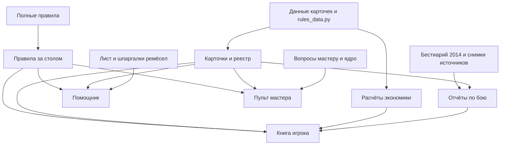

# Собрать и проверить проект

Codex, 09.10.2026. Техническая инструкция по текущим сборщикам.

**Как читать.** Для проверки ветки используй одну команду ниже. Для изменения документа найди его исходник в таблице. Порядок ведения проекта Codex — в [AGENTS.md](../AGENTS.md), текущий снимок и перенос сохранений — в [состоянии проекта](../Состояние%20проекта.md).

Проверка цен по Ж-150: `python3 -B scripts/elixir_price_audit.py --check`. Область — эликсиры-эффекты, масла оружия и мази; база — лучшие доступные чернила II и выше, потолок 120%. Расчёт учитывает партии и бонусы 8.12. Таблица игроку: `Цены эликсиров — проверка прибыли.md`, сборка через `--write`.

## Быстрая проверка по области

```bash
python3 -B scripts/check_all.py --quick
```

Область определяется по изменениям относительно основной ветки, включая незакоммиченные и новые файлы. Неизвестный общий код, общие правила и изменения нескольких областей требуют полного прогона. Без истории Git используй явную область.

| Изменение | Команда сборки и проверки |
| --- | --- |
| Текст документа | `python3 -B scripts/check_all.py --scope text --files "Документ.md" --build` |
| Дополнение лога, записки, предыстории | `python3 -B scripts/check_all.py --quick --files "Путь к исходнику.md" --build` |
| Алгоритм выбора проверок и CI | `python3 -B scripts/check_all.py --scope checks` |
| Подтверждённые остатки | `python3 -B scripts/check_all.py --scope inventory --build` |
| Интерфейс и код помощника | `python3 -B scripts/check_all.py --scope helper --build` |
| Материалы и пульт мастера | `python3 -B scripts/check_all.py --scope master --build` |
| Проверки экономики без пересборки | `python3 -B scripts/check_all.py --scope economy --sources` |
| Шаэрра | `python3 -B scripts/check_all.py --scope shaerra --sources` |

Точечная команда работает в свежей временной копии без `.git`. `--build` переносит только явно разрешённые результаты после успешных проверок; при ошибке или посторонних изменениях запись отменяется. Без `--build` checkout не меняется. В областях `inventory`, `helper`, `master`, `shaerra` относящиеся к ним браузерные проверки обязательны. `--slow` предназначен для полного прогона экономики, а не для точечной сборки. Обычная правка README не пересобирает книгу.

Для источников библиотеки область `library` берётся из списка фактически читаемых материалов, без отдельного ручного реестра путей. Она собирает библиотеку и проверяет её актуальность. После добавления диалога достаточно сверить изменённую сцену с сообщением игрока и выполнить эту сборку; тесты интерфейса, поиска, печати и буфера обмена нужны при изменении их кода или шаблона. В `checks` запускаются тесты выбора области и чтения источников; браузер и расчёты экономики не запускаются.

`--quick --plan --files ...` печатает JSON плана без сборки и тестов. `automatic: false` означает, что автоматических проверок нет. Обычный запуск такого плана возвращает **2** и сообщение «ПРОПУЩЕНО»: это не ошибка текста и не успешный прогон. Для README и других текстов без сборщика остаётся ручная сверка diff. Код **1** означает ошибку или устаревший результат; **0** — выполненную сборку/проверку. `--files` без путей явно задаёт отсутствие изменений.

## Один источник запасов

`Источники/Сохранения/current.json` содержит только имя подтверждённого датированного снимка в той же папке. `current_inventory.py` читает его для начальных запасов помощника и генерирует блоки `current-*` в листе, включая монеты. История, происхождение предметов и остальной лист остаются ручными. Боевые параметры по-прежнему берутся из листа.

После подтверждённой операции сохрани новый JSON, переключи указатель и выполни `--scope inventory --build`. Команда сверяет сумки, перенос старого сохранения, эссенции, отсутствие дублей и сохранность ресурсов после перезагрузки. Старые снимки не изменяются. Действующая сумка браузера самостоятельна: новая сборка не сбрасывает её и не объявляет снимок точнее последующих действий игрока.

## Проверить всё одной командой

```bash
python3 -B scripts/check_all.py --slow --browser
```

Команда запускает тесты Python, проверяет карточки, воспроизводимость отчётов, сборку HTML и ссылки книги, затем браузерные сценарии. Она работает во временной копии без `.git` и сообщает об устаревших результатах. Исходный checkout не изменяется. Без `--slow` пропускается пересчёт экономики; без `--browser` — Playwright.

`check_master_rulings.py` внутри общей проверки сверяет применение Ж-148/149: уровни без надбавки за концентрацию, сохранённые отдельные повышения, сроки, токсичность, компоненты и текущие статусы вопросов.

Python-сборщики используют стандартную библиотеку. Браузерным проверкам нужны Node.js 22, Playwright и Chromium. Версия Playwright закреплена в [ci/package-lock.json](ci/package-lock.json). Каталог `node_modules` устанавливай вне проекта; путь передавай через `NODE_PATH`. Путь к Chromium задаётся переменной `PLAYWRIGHT_CHROMIUM_EXECUTABLE_PATH`.

[GitHub Actions](../.github/workflows/check.yml) выбирает область по фактическому diff push или pull request, в том числе для основной ветки. План строится до установки зависимостей: для логов не устанавливаются Playwright, Chromium и ESLint. Полный прогон и сетка Монте-Карло остаются для общих изменений и ручного запуска. Пустой план явно отмечается в сводке как пропуск, без заявления о пройденных тестах. Workflow проверяет ветку; публикацию артефактов он не выполняет.

Для правки только краткого итога цен в экономике мастеру используйте `python3 -B scripts/report.py --price-summary-only` в свежей временной копии. Команда берёт четыре изменения из `cards/price_adjustments.json`, сохраняет остальные расчёты и не запускает Монте-Карло. Полные технические отчёты о симуляции и ценах открываются отдельно по ссылкам; книгу игрока они целиком не увеличивают.

## Найти исходник документа

| Исходник | Сборщик | Результат |
| --- | --- | --- |
| Полные правила v0.3 | `rules_html.py` → `table_rules.py` → `rules_html.py table` | Полный HTML, Markdown и HTML правил за столом |
| `cards/cards_data.py`, `cards_meta.py`, `rules_data.py`, функции `cards_model.py` | `cards/gen.py`, `cards/quality.py` | Карточки, реестр CSV, бонусы качества |
| Карточки и снимки `cards/src/` | `cards/registry.py` | Реестр расхождений с источниками |
| Правила за столом, лист Талиса, снимок по `current.json`, карточки, `helper_tpl.html`, `table_tools.js`, шпаргалки ремёсел | `cards/helper.py` | Помощник варки |
| Вопросы мастеру, ядро, карточки, разрешённая часть листа, образец, `master_tpl.html` | `cards/master_panel.py` | Пульт мастера |
| `rules_data.py`, `sim*.py` | `report.py`, `weekly_economy_report.py --write` | Экономика, симуляция, таблицы недельного бюджета |
| `bestiary/srd2014-monsters.json`, модели боя | `bestiary_report.py --write`, `alchemy_bestiary_report.py --write` | Две области общего разбора «Талис — алхимия, заклинания и метамагия» и прежние CSV |
| Модели боя, карточки, `alchemy_bestiary/web-review/` | `alchemy_magic_review.py --write` | Область метамагии в общем разборе и CSV; границы областей задаёт `magic_guide.py` |
| Карточки и модели снабжения | `party_kit_report.py --write`, `elixir_catalog_review.py --write` | Модель снабжения и `party-growth` — первый скрипт; `party-shortlist` из карточек и полный каталог — второй. Остальной текст справки пишется вручную |
| Markdown с парным HTML | `master_html.py "Имя документа"` | HTML документа |
| Книга Markdown, документы из `DOCUMENTS`, `player_book_tpl.html` | `player_book.py` | Книга HTML и два архива |



После изменения исходников собирай результаты во временной копии: правила → карточки → расчёты → помощник и пульт → парные HTML → книга. Команды общей проверки хранятся в `check_all.py`; подробности расчётов — в README их папок. Проверочная команда обнаруживает устаревший файл, но не обновляет checkout автоматически.

## Узнать, какую сборку проверял рецензент

В помощнике и пульте внизу есть раскрываемая строка «Сборка …». Это первые 12 знаков SHA-256 содержимого страницы до добавления служебных меток. Идентификатор меняется вместе с содержимым и воспроизводится в архиве без Git. Он не является SHA коммита. В отзыве укажи его и коммит проверенной ветки.

В сгенерированных Markdown и HTML есть комментарии `AUTO-GENERATED FILE` с путями сборщика и исходника. В документах, где скрипт обновляет только часть текста, используется `GENERATED SECTION`: ручные заметки сохраняются. Маркировка Markdown с маршрутом чтения находится внутри блока `reading-guide`; она не меняет тело правил.

## Сверка второго внешнего отзыва

- Единая команда проверки, тесты Python и браузерные сценарии уже существуют. Перенос на pytest для запуска CI не требуется.
- В расчётах бестиария уже есть `lru_cache`; `validate_sources()` проверяет опорные карточки, а `verify_sources()` — контрольные суммы интернет-снимков.
- `WRITING.md` задаёт стиль, `WRITING_QUICK.md` служит короткой памяткой со ссылкой на него. Длинных шаблонных промптов для переноса в `prompts/` в `AGENTS.md` нет.
- SRD 2024, печатные сетки и экспорт в VTT — отдельные расширения продукта.
- **Рекомендация Codex:** добавлять Pydantic, pandas, Jinja2 и линтеры под конкретную задачу с проверкой совместимости. Добавление библиотеки само по себе не доказывает ускорение или исправление ошибки.
- Раскладка файлов и хранение расчётных результатов в Git сохраняются по инструкции проекта. Собранные страницы остаются автономными.

## Где хранятся архив и дополнительные страницы

Датированные исторические отчёты перенесены в `Архив/Проверки/` вместе с пятью
HTML-версиями. Действующие разборы остаются в корневых Markdown; восемь их
отдельных HTML расположены в `Дополнительные материалы/`. Правила, карточки,
книга, помощник, пульт и материалы мастеру остаются в корне.

Имена CLI сохраняются: `master_html.py "Имя документа"` находит исторический
источник и выбирает папку результата через `document_paths.py`. Полная
проверка пересобирает пары из всех трёх папок; оригиналы в `Источники/`
в этот обход не входят. Изображения привязаны к папке Markdown и при сборке
пересчитываются относительно папки HTML.

Карта переноса и проверки — `document_paths.py` и `test_document_paths.py`.
Расчётные CSV, снимки интернет-источников и исходники книги сохранены.

## Справочник правил и проверка документов

Цены, СЛ и параметры моделей — в `rules.json`; совместимые Python-таблицы и данные помощника — через `rules_data.py`. [Порядок переноса и проверки](audit_tools/README.md) описывает именованные сценарии, явный вид предмета и команды сверки ядра, шпаргалки и экономики.

## Логи, записки и предыстория

`python3 -B scripts/campaign_library.py` собирает отдельную страницу игрока «Для игрока — логи, записки и предыстория.html». Логи и вложенные записки копируются отдельно, шесть опорных разговоров сохраняют название группы, найденные документы идут отдельными карточками. Кнопка копирует исходный Markdown без пересказа; текст доступен без JavaScript, копирование — через буфер браузера с резервным выделением.

У каждой карточки короткая метка (S01–S17, ЗТ, КВ, ОД, ДМ, РС; ссылка `#S13` открывает карточку), у логов — итог сессии; итоги и пояснения к подписям лежат в `scripts/campaign_library_notes.json`. Квента делится на три части по строкам-границам `STORY_PARTS`. Поиск не различает «е» и «ё», раскрывает найденные карточки и подсвечивает совпадения. Сборщик текст источников не меняет: опечатки исправлять в самих «Источники/», буквальную звёздочку писать как `\*`. Проверка актуальности: `python3 -B scripts/campaign_library.py --check`; браузерная проверка — `node scripts/test_campaign_library.cjs`. Сборку запускать в свежей временной копии без `.git`.

## Комплект мастеру

После пересборки HTML: `python3 -B scripts/master_pack.py`. Проверка списка файлов, приватности и локальных ссылок: `--check` (включена в check_all.py). Архив собирается во временной копии, в Git не хранится. Список разрешённых документов задан явно; книги, лист и сохранения игрока не включаются. Ответы уточнения 12.11 хранятся отдельно: `manswers-followup-20261112` локально, `answers_followup_20261112` в пульте при доступном общем хранилище. Прежние `manswers` и `answers/qN` не перезаписываются.


## Общий код сборщиков

`cards_model.py` готовит карточки и задаёт единый порядок через `ordered_cards`. Каталог, помощник, пульт и рекомендации качества используют эту функцию. Сборщики импортируют нужные данные и функции напрямую; `quality.py` не служит промежуточным хранилищем всего каталога и готовит его только при запуске своей команды.

Полный и точечные прогоны используют один `run_browsers` в `check_all.py`: локальный HTTP-сервер закрывается и после ошибки, а настройки окружения вызывающей проверки не меняются. Отдельные страницы игрока и мастера сохраняют свой состав данных и автономную работу.


Сборка Markdown, CSV и HTML карточек объединена в `python3 -B scripts/cards/gen.py`: данные готовятся один раз. `gen_html.py` удалён. Пульт читает готовый каталог; при отдельном запуске сначала выполнить `cards/gen.py`. Общая проверка и область `master` соблюдают этот порядок и не запускают каталог повторно из пульта.

Проверки JavaScript объединены в `check_javascript.cjs`: `node scripts/check_javascript.cjs` компилирует исходники и встроенные скрипты без исполнения, `--lint` добавляет ESLint. Файлы читаются одним обходом; сборочные маркеры, синтаксические ошибки, прежние структурные правила и неизвестные имена в страницах проверяются вместе. `lint_javascript.cjs` удалён. Для `--lint` нужны закреплённые зависимости из `scripts/ci/`.


## Где лежит код помощника

`helper_tpl.html` задаёт каркас страницы; `table_storage.js`, `table_combat.js` и `table_materials.js` содержат хранение, бой и материалы. `helper.py` встраивает их при сборке в прежнем порядке, вместе с модулями подбора и планирования. Скачиваемый HTML остаётся одним автономным файлом. Общий синтаксис ссылок Python-рендереров находится в `markdown_links.py`, а правила адресов остаются у каждого рендерера.

## Анализ развития Талиса

`development_strategy.py --check` сверяет единый `development_strategy/results.json`: совместная цепочка чернил и свитков I–III, конечные ресурсы, параллельность, смешанный запас/продажа, практика до M5 и выбранные тактические средства; `mixed_programs` сравнивает 8/12/20 часов со стартом из неизвестных рецептов и с освоенными. В этих программах нет перебросов, натуральная 1 требует нового решения, повышение завершает программу; сырьё начатой партии резервируется целиком. `--write` — только в свежей временной копии. Руководство игроку — «Талис — стратегия развития алхимии.md/.html»; проверочные таблицы — «Талис — стратегия развития алхимии — расчёты.md/.html». Каталог повторно не выгружается. Ставка Гильдии 75% за собственные свитки подтверждена справочником цен полных правил; доход не назначается личным кошельком Талиса. Модель не меняет игровые сохранения. Независимое случайное сравнение переходов находится в `test_development_strategy.py`.
